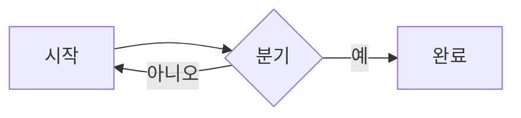
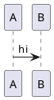

# [회의록] 플레이 테스트 리뷰

[[TOC]]

## 0. 한눈에 보기

1. 릴레이 소설은 **유지하고 고도화**한다.
2. 소설 속 "나"는 플레이어와 나켓이 공유하는 **동일 인물(1인칭)**로 고정한다.
3. 먼저 **맞출 대상(왜/어떻게)**을 확정한다. https://example.com 자동 링크.

## 1. 문법

H~2~O, 19^th^, ++삽입++, ==강조==, :sparkles: :+1:, 각주[^1].

*[HTML]: Hyper Text Markup Language

HTML 은 약어다.

용어
: 정의 설명

- [x] 완료
- [ ] 미완료

> [!NOTE]
> 참고 블록입니다.

> [!WARNING]
> 경고 블록입니다.

### 1.1 코드

```kotlin
fun main() {
    val items = listOf(1, 2, 3).map { it * 2 }
    println("Hello, $items")
}
```

### 1.2 표

| 이름 | 값 | 설명 |
|------|---:|------|
| A | 1 | 첫째 |
| B | 2 | 둘째 |

### 1.3 수식

인라인 $\sqrt{3x-1}+(1+x)^2$ 그리고

$$
\int_0^1 x^2\,dx = \frac{1}{3}
$$

## 2. 다이어그램






## 3. 끝

[다른 문서](other.md)

[^1]: 각주 내용.
